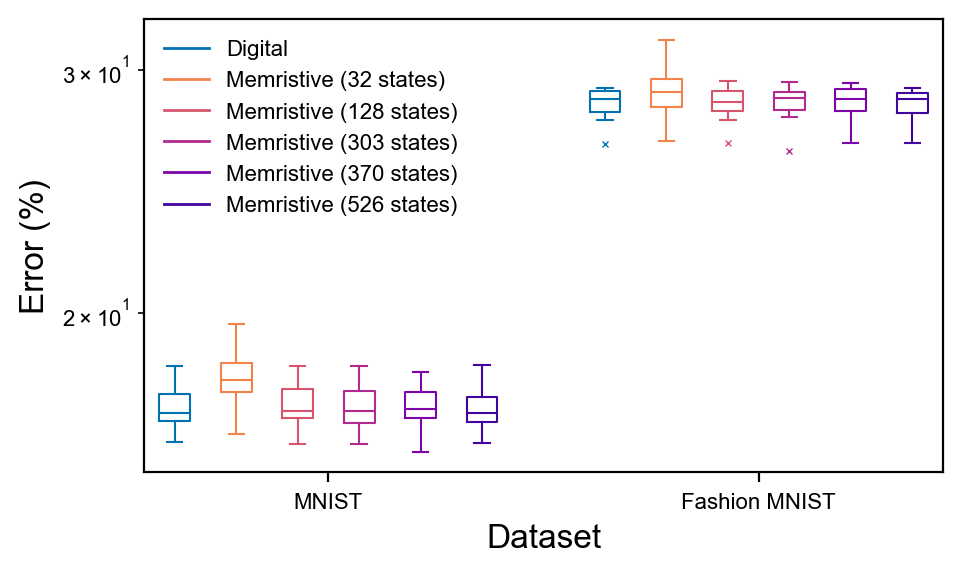

# Simulating Memristive Neural Networks

Parts of the code are adapted from [this](https://github.com/joksas/nonideality-aware-mnn-training).

## Requirements

Python 3.11 and the packages listed in [requirements.txt](requirements.txt).

## Reproducing results

To reproduce the results, run the following script:
```python
from mnn import simulations
from mnn.plotting import figures


simulations.discretisation.run()
figures.discretisation_boxplots()
```
Random seeds were not specified, so quantitative results might differ *slightly*.
Qualitative results should remain the same, however.

## 本仓库的独立复现记录

本 Fork 由 Ian578adsa 用于记录作者公开代码默认离散化仿真的独立运行结果。原始器件数据来自作者的 NBT（钛酸铋钠）研究；本次未替换为个人器件数据，仅仅只是原始器件代码重跑。

### 来源与复现范围

- 原始代码：[joksas/mnn-cam](https://github.com/joksas/mnn-cam)。
- 使用的上游版本：[`636001ed7bc67e7f9109815d73430db62e16704f`](https://github.com/joksas/mnn-cam/commit/636001ed7bc67e7f9109815d73430db62e16704f)。
- 对应论文：M. Xiao et al., *Ultra-Fast Non-Volatile Resistive Switching Devices with Over 512 Distinct and Stable Levels for Memory and Neuromorphic Computing*, Advanced Functional Materials 35, 2418980 (2025). [DOI: 10.1002/adfm.202418980](https://doi.org/10.1002/adfm.202418980)。
- 复现运行日期：2026-10-17（Asia/Shanghai，以输出文件修改时间为依据）；成果完整性复查日期：2026-10-18。
- 环境：Windows、Python 3.11.17、TensorFlow 2.15.0；[完整依赖版本](results/environment.txt)。
- 范围：运行 `simulations.discretisation.run()`，使用 MNIST 和 Fashion-MNIST，各训练 10 个网络，每个网络训练 2 个 epoch；比较 Digital 基线与 32、128、303、370、526 个实测电导状态。
- 沿用作者默认的未固定随机种子设置。本次是公开代码默认流程的计算复现，不代表器件制备复现或整篇论文全部实验的复现，也未逐项确认与论文报告数值一致。

### 本次运行结果

表中为 10 次网络训练对应的测试准确率均值 ± 样本标准差。每次测试使用相应数据集的 10000 张测试图像。

| 配置 | MNIST 准确率 (%) | Fashion-MNIST 准确率 (%) |
| --- | ---: | ---: |
| Digital | 82.962 ± 0.656 | 71.662 ± 0.826 |
| 32 个电导状态 | 82.107 ± 0.959 | 71.177 ± 1.372 |
| 128 个电导状态 | 82.900 ± 0.691 | 71.651 ± 0.843 |
| 303 个电导状态 | 82.936 ± 0.676 | 71.642 ± 0.907 |
| 370 个电导状态 | 82.947 ± 0.665 | 71.602 ± 0.851 |
| 526 个电导状态 | 82.996 ± 0.664 | 71.698 ± 0.798 |



图中纵轴为错误率（Error %），表中为准确率，两者的数值方向相反。

- [全部 120 条准确率记录](results/accuracy_runs.csv)
- [12 组配置的数值汇总](results/accuracy_summary.csv)
- [运行日志](results/run.log)
- [PDF 图](plots/discretisation-boxplots.pdf)

### 运行与改动

在项目根目录，使用 Python 3.11 独立环境执行：

```powershell
python -m pip install -r requirements.txt
python run_reproduction.py
```

本 Fork 保留上游计算源码，新增 `run_reproduction.py` 入口及结果展示，并补充 `openpyxl==3.1.5`、`tensorflow-metadata==1.15.0`。模型权重与中间数组保留在本地 `_gen/`，不提交环境和训练缓存。

原代码会跳过已存在的训练目录，并跳过写入已存在的部分数值结果。开始新一轮实验前，应将上一轮 `_gen/` 完整移出或改名留存，避免混用旧结果；`results/run.log` 默认会追加记录。

### 检查状态与已知限制

2026-10-18 重新运行 `python -B -m pytest -q -p no:cacheprovider`：**4 passed，1 failed，3 warnings**。失败项为 `tests/crossbar/test_nonidealities.py::test_line_resistance[args0-expected0]`，在线电阻分块计算中出现 `slice index 2 of dimension 0 out of bounds`。该代码与上游版本一致；本次默认离散化流程不启用线电阻功能。未将整套测试标记为通过，也未修改或跳过该失败测试。

已核查两个数据集共 20 个权重文件、20 个训练历史文件和 34 个推理结果数组。12 组准确率数组均为 `(10, 1)`，数值有限且在 `[0, 1]` 范围内；结果图、PDF 和运行日志均存在。发布前未重新进行完整训练。

原有署名与 GPL-3.0 许可证保留；原方法和器件数据来自原作者，本仓库新增的内容为运行入口、环境补充、复现结果及记录。
